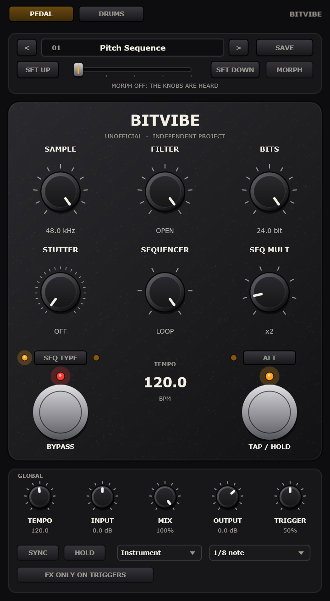
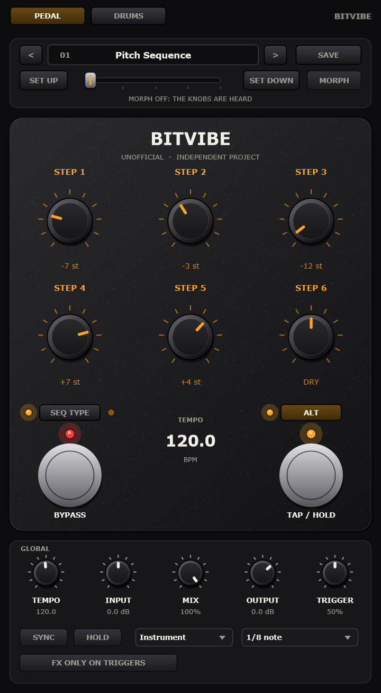
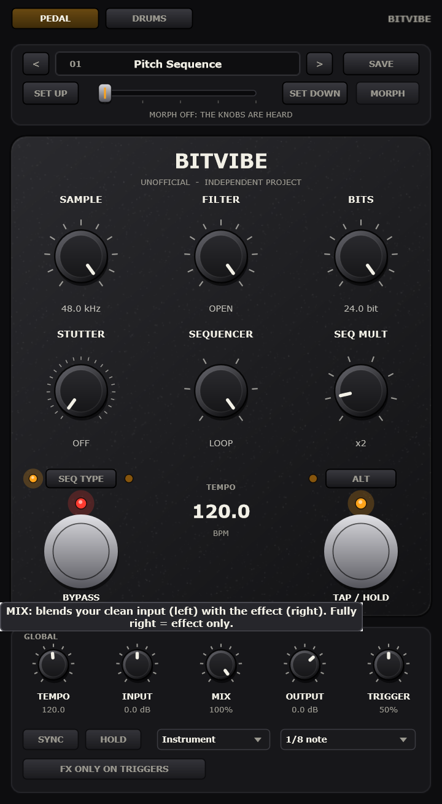
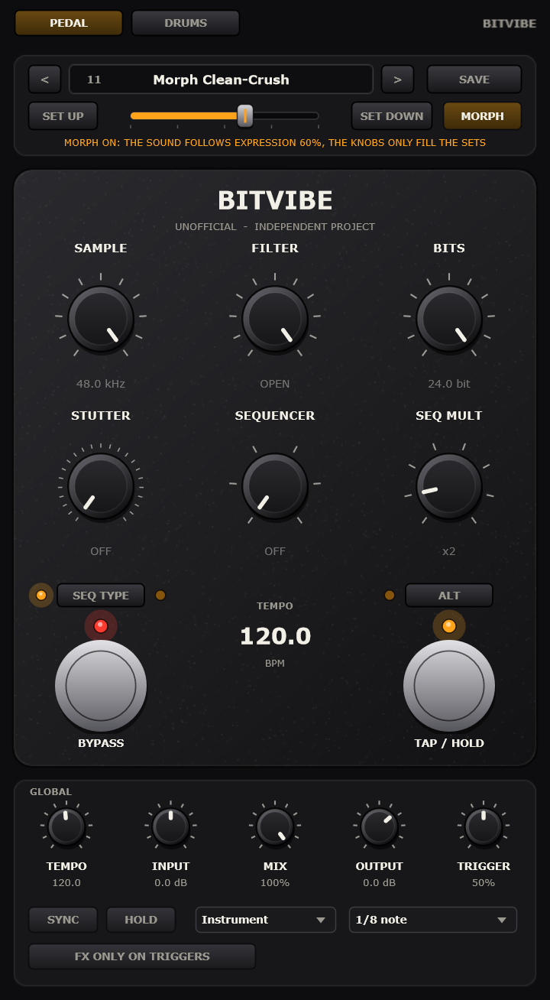
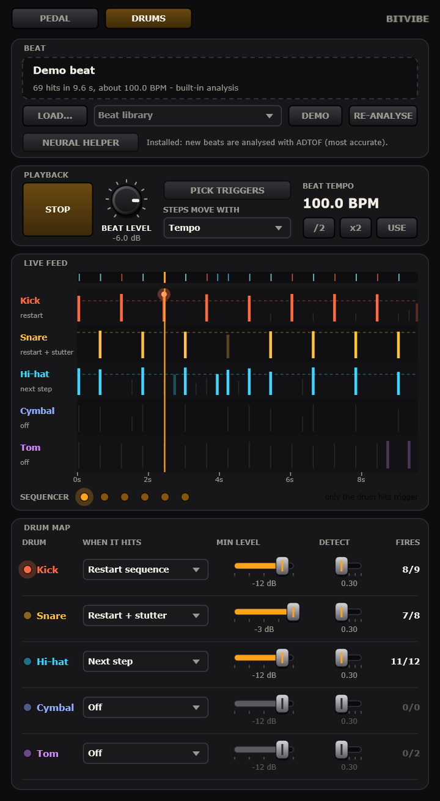

# BitVibe

<table>
  <tr>
    <td align="center"><br><sub>Front panel</sub></td>
    <td align="center"><br><sub>Alt layer: the six sequencer steps</sub></td>
  </tr>
</table>

**BitVibe** is a free, open-source bitcrusher / ladder-filter / stutter / 6-step-sequencer effect for
guitar and synths: a **VST3** plug-in (plus **Audio Unit** on macOS and a **Standalone** app). It is written
from scratch in C++ with [JUCE](https://juce.com) and is inspired by a hardware pedal (see
[Credits](#credits-and-licence)). The aim is to put those ideas, plus some extras only a plug-in can offer,
in the hands of more people for free.

> **Status: early version (0.1.0), work in progress.** The sound engine is covered by automated tests
> and the plug-in loads and runs in a test host, but it has had little real-world use in DAWs, and the
> macOS build has not been run on a real Mac yet. Bug reports are welcome.
>
> BitVibe is an independent, unofficial project. It is not affiliated with or endorsed by the makers of
> the hardware that inspired it, and it contains none of their code, firmware or artwork.

[Features](#features) · [Install](#install) · [Using it](#using-it) · [Design notes](#design-notes) · [Building](#building-from-source) · [Credits & licence](#credits-and-licence)

## Features

- **Sample-rate reduction** from 48 kHz down to 48 Hz and **bit-depth reduction** from 24 bit to 1 bit
  (with a noise gate below 8 bit).
- **Ladder-style low-pass filter**, 96 Hz to 24 kHz.
- **Stutter** with 23 positions (3 speeds × 7 repeat counts, off and random) and a hold to freeze it.
- **6-step sequencer** for pitch (±12 semitones), filter cutoff or sample rate, with per-step skip/mute,
  1× to 128× tempo multiplier and tap tempo from 23.4 to 6000 BPM (fast enough for ring-mod tones).
- Stutter and sequencer are triggered by **pick-attack detection**.
- **Drum map** (DRUMS tab): load a drum loop (WAV or MP3), BitVibe finds its kick, snare, hi-hat, cymbal and
  tom hits, and each drum can restart the sequence, step it or fire the stutter when it hits hard enough. A
  live feed shows the hits and what they trigger. An optional neural transcriber (ADTOF) gives the best
  accuracy.
- **Expression morph:** store two complete sets of knobs (including the six step knobs), "toe up" and
  "toe down", and sweep smoothly between them with one automatable **Expression** parameter.
- **16 preset slots**, each a full sound including its two morph sets, with names you can edit, shown in
  the plug-in and in your DAW's program list.
- **Mix knob** to blend your clean input with the effect, and an option to apply the sample-rate, bit and
  filter effects **only while the stutter or sequencer is playing**, so your playing stays clean in between.
- **Hover tips:** rest the mouse on any control for a short, plain-language description of what it does.
- **Plug-in extras:** tempo sync to the host, all 30 parameters automatable, input and output gain,
  adjustable trigger sensitivity and stutter length, and processing that stays in stereo. No reported
  latency, and light on CPU (under 1 % of one core in my measurements).

## Install

Prebuilt installers will be attached to the [Releases](https://github.com/d0ge5/BitVibe/releases) page.
**None have been published yet**; until then, build them yourself (see
[Building from source](#building-from-source)).

| System | Installer | What it installs |
| --- | --- | --- |
| Windows 10/11, 64-bit | `BitVibe-<version>-Windows-x64-Setup.exe` | VST3 plug-in, optional Standalone app |
| macOS 11+, Apple Silicon or Intel | `BitVibe-<version>-macOS.pkg` | VST3, Audio Unit, optional Standalone app |

Neither installer is code-signed, so your system will warn you the first time.

**Windows**

1. Run the setup. If Windows shows "Windows protected your PC", choose **More info → Run anyway**.
2. Pick **Install for all users** (asks for an administrator password) or **Install for me only**.
3. Accept the licence, choose the full install or the plug-in only, and finish.
4. Open your DAW and rescan plug-ins. BitVibe is listed under **Fx / Distortion**.

No extra runtime is needed. "Install for me only" uses `%LOCALAPPDATA%\Programs\Common\VST3`, which some
DAWs do not scan by default; if the plug-in is missing, add that folder to the DAW's plug-in paths.
Uninstall from *Settings → Apps*.

**macOS**

1. Open the `.pkg` (right-click → **Open** if macOS blocks it).
2. On the *Customize* page tick the formats you want (VST3, Audio Unit, Standalone) and install; it asks
   for your password because it installs for all users.
3. Restart your DAW. Logic Pro uses the Audio Unit and may take a minute to validate it the first time.
4. If macOS blocks the plug-in, open **System Settings → Privacy & Security** and choose **Open Anyway**.

To uninstall, delete `/Library/Audio/Plug-Ins/VST3/BitVibe.vst3`,
`/Library/Audio/Plug-Ins/Components/BitVibe.component` and `/Applications/BitVibe.app`.

## Using it

The window has two tabs. **PEDAL** is laid out like a guitar pedal: six knobs, a bypass footswitch, a tap
footswitch and a sequencer type switch, with a preset and expression-morph strip on top. **DRUMS** holds the
[drum map](#drum-map-drums-tab).

| Knob | What it does | Alt layer |
| --- | --- | --- |
| **Sample** | Sample-rate reduction, 48 Hz – 48 kHz (fully clockwise = off) | Step 1 |
| **Filter** | Ladder low-pass, 96 Hz – 24 kHz (fully clockwise = off) | Step 2 |
| **Bits** | Bit depth, 24 → 1 bit (fully clockwise = off) | Step 3 |
| **Stutter** | Off, then full / double / half speed × 1, 2, 3, 4, 6, 8 or 16 repeats, then random | Step 4 |
| **Sequencer** | How many passes: off, once, twice, 4×, 8×, continuous | Step 5 |
| **Seq Mult** | Sequencer speed as a multiple of the tempo, ×1 … ×128 | Step 6 |

- **ALT** swaps the knobs to the six sequencer steps (they turn orange). A step at minimum is
  **skipped**, at maximum it is **muted**.
- **SEQ TYPE** cycles what the sequencer controls: **Pitch** (each step −12 … +12 semitones, centre =
  unshifted), **Filter** or **Sample Rate** (each step is 0–100 % of the front-panel value). The two small
  LEDs show the type; both off means Sample Rate.
- **TAP** sets the tempo. **Hold it** (or use the HOLD button) to freeze the stutter; you can press it
  before playing so the next note is the one that gets frozen.
- **BYPASS** switches the effect in and out. It is also wired to your host's bypass.
- The **Global** panel adds what a plug-in needs: tempo, input/output gain, **Mix**, **Trigger** sensitivity
  for the attack detector, host tempo **Sync**, instrument/line **Headroom**, the stutter snippet length and
  the **FX ONLY ON TRIGGERS** switch (both explained below).

It starts on preset 1, a factory sound: the pitch sequencer running (steps −7, −3, −12, +7, +4, 0
semitones). Turn **Sequencer** to *Off* for a clean signal. If the stutter or sequencer misses notes or
triggers on noise, adjust **Trigger**, and try feeding the plug-in the dry guitar signal first.

### Mix and effects only on triggers

- **MIX** blends your clean input (fully left) with the effect (fully right, the default). The clean signal is
  your input as it arrives, before the input gain; the output gain applies to the blend; and **BYPASS** always
  gives back the untouched input.
- **FX ONLY ON TRIGGERS** changes when the sample-rate, bit-depth and filter effects act. Normally they are
  always applied. Switch this on and they only act while the **stutter** or the **sequencer** is playing: they
  fade in when a picked note starts one and fade out when it ends, so your playing stays clean in between.
  The stutter and the sequencer themselves (the repeats, the pitch steps, the muting) work as usual either
  way. With the Sequencer knob on *LOOP* the sequencer never stops, so the effects stay on, and with both the
  sequencer and the stutter off nothing ever triggers, so the signal passes through clean.
- Neither setting is stored in a preset: like the output level, they belong to your rig and keep their
  values when you change preset.

### Hover tips

<p align="center"></p>

Rest the mouse on any knob, switch, button or the preset bar for about half a second and a short description
appears. The text for the six step knobs on the Alt layer follows the sequencer type: it says whether a step
sets a pitch, a filter cutoff or a sample rate.

### Presets



The bar at the top of the window holds **16 preset slots**. The `<` and `>` buttons step through them (wrapping
around), and the same list appears as the plug-in's programs in your DAW. Double-click the name to rename a
slot.

- A slot remembers the sound: the six knobs, the six step knobs, the sequencer type, tempo, stutter length,
  the morph switch and the two morph sets. It does **not** remember what belongs to your rig or to the
  moment: bypass, stutter hold, host sync, the Expression position, input / output gain, headroom,
  trigger sensitivity, the mix and the FX-only-on-triggers switch keep their values when you change preset.
- Recalling a slot loads its sound. Changes you make afterwards are kept in the session (an orange dot next
  to the name says the slot has unsaved changes) but are only written into the slot by **SAVE**; changing
  slot first discards them. Selecting the slot you are already on does nothing, so a host that re-selects
  the current program after loading a project cannot wipe your changes.
- Slots 1 to 12 are factory sounds (slot 1 is the default pitch sequence, 11 and 12 demonstrate the morph),
  slots 13 to 16 are clean and meant to be overwritten. All sixteen are saved with your project.

### Expression morph

The strip under the preset bar has a horizontal **Expression** slider between **SET UP** and **SET DOWN**.

1. Set the knobs (and, on the Alt layer, the six steps) for the sound you want with the pedal's toe up and
   press **SET UP**. The 12 knob positions and the sequencer type are stored as the *toe-up* set.
2. Change the knobs to the other sound and press **SET DOWN** for the *toe-down* set.
3. Switch **MORPH** on. The sound now comes from the two stored sets, blended by Expression: 0 % is the
   toe-up set, 100 % the toe-down set. While Morph is on the knobs only matter when you capture a set, and
   their readouts are dimmed. Switch it off to hear the knobs again.

Expression and Morph are ordinary plug-in parameters, so you can automate them or map a MIDI pedal to them
in your DAW. The blend is computed for every audio block: the three effect knobs and the six steps move
smoothly (the frequency knobs glide the same way turning them would), while the discrete ones - stutter
position, sequencer passes, multiplier and type - jump from the toe-up to the toe-down value at the
midpoint (50 %). A pitch step swept between two values passes through every semitone zone in between (and
through *skip* / *mute* if a set puts that step at the very end of the knob).

### Drum map (DRUMS tab)



The **DRUMS** tab lets a drum beat play the sequencer and the stutter, instead of (or as well as) your
picking. BitVibe listens to the beat, finds the **kick, snare, hi-hat, cymbal and tom** hits, and you decide
what each drum does when it hits hard enough.

1. **Load a beat.** Drag a WAV, MP3, AIFF, FLAC or OGG file onto the box at the top, use **LOAD...**, pick
   one from the **library** (the files in `Documents/BitVibe/Beats`, and in the [`beats/`](beats) folder for
   a build made from this source tree), or press **DEMO** for a built-in synthetic beat. BitVibe analyses it
   in the background in a few seconds and shows how many hits it found and the beat's tempo. MP3 is read
   with your operating system's own decoder. Files longer than five minutes are cut.
2. **Play it.** **PLAY** loops the beat from the top at its own speed (it does not follow your DAW's
   timeline). **BEAT LEVEL** sets how loud you hear it; it is mixed in after the effect, so the drums are
   never crushed. Fully down the beat is silent but still triggers. **USE** sets BitVibe's tempo to the
   beat's; **/2** and **x2** fix a tempo detected at half or double speed.
3. **Map the drums.** For each drum choose what a hit does: **Restart sequence**, **Next step**,
   **Stutter**, or **Restart + stutter** (what a pick does). **MIN LEVEL** is how loud a hit must be, in dB
   below the loudest hit of that drum in the beat, and **DETECT** how sure the analysis must be that it
   is that drum. By default the kick restarts the sequence and the other drums do nothing.

- **PICK TRIGGERS** off: only the drum hits trigger, your picking no longer does.
- **STEPS MOVE WITH** *Drum hits*: the sequencer only steps on hits set to **Next step**, so the drums
  clock the sequence (with *Tempo*, a Next step hit jumps one step and the tempo carries on from there).
- The **live feed** draws every hit as a bar as tall as it is loud: bright bars fire, dim ones are below the
  dashed Min level line or belong to a drum that is off, crossed ones are excluded. Hits flash as they fire,
  and the six lights show the sequencer's step. **Click** a hit to exclude it (or include it again);
  **right-click** it to move it to another drum or delete it. RE-ANALYSE starts again and discards these edits.
- The beat file, its hits (with your edits) and the drum settings are saved with your project. If the file
  has moved, the hits still trigger but the beat is silent. Like the mix and the output level, the drum map
  belongs to your rig and is not part of the presets. Your host's **bypass** silences the beat and its
  triggers.

#### How accurate is the analysis?

There are two analysers. The **built-in** one always works. It is a classic signal-processing transcriber:
onset detection, then a non-negative matrix factorisation of each hit's spectrum into five drum templates
that adapt to the kit. The optional **neural helper** runs [ADTOF](https://github.com/MZehren/ADTOF), a
drum-transcription network trained on a large set of real recordings and one of the most accurate open
models, especially for cymbals. Measured with [`Tools/DrumEval.cpp`](Tools/DrumEval.cpp) (F-measure, 50 ms
tolerance, at the default DETECT setting of 0.30; 1.00 = every hit found and nothing extra):

| Drum | Built-in, MDB Drums | Neural, MDB Drums | Built-in, IDMT loops | Neural, IDMT loops |
| --- | --- | --- | --- | --- |
| Kick | 0.95 | 0.96 | 0.94 | 0.99 |
| Snare | 0.75 | 0.81 | 0.83 | 0.87 |
| Hi-hat | 0.80 | 0.87 | 0.92 | 0.95 |
| Cymbal | 0.48 | 0.86 | - | - |
| Tom | 0.24 | 0.22 | - | - |
| All hits | 0.77 | 0.84 | 0.81 | 0.93 |

MDB Drums is real acoustic drumming in many styles, IDMT-SMT-Drums is drum loops (acoustic, sampled and
electronic) with kick, snare and hi-hat only. Neither dataset is part of BitVibe. The built-in analysis is
solid on kick, snare and hi-hat but weak on cymbals (a crash is often taken for a hi-hat); for cymbals, busy
or quiet playing, use the neural helper, or tidy the hits by hand in the feed. Toms are rare in these
recordings (90 of almost 8000 hits) and both analysers report too many of them at the default setting: if
you map toms, raise their DETECT (around 0.6 worked best for the neural helper).

**Setting up the neural helper (optional).** It needs Python 3.9 or newer (tested with Python 3.14 on
Windows) and downloads about 350 MB (PyTorch, librosa and ADTOF) into its own folder:

- Windows: run [`Tools\drums\setup_neural.bat`](Tools/drums/setup_neural.bat). It installs into
  `%LOCALAPPDATA%\BitVibe\neural`.
- macOS: run `sh Tools/drums/setup_neural.sh`. It installs into
  `~/Library/Application Support/BitVibe/neural` (not tried on a Mac yet).

Afterwards the line under the beat box says *Installed*, and new beats (and RE-ANALYSE) use ADTOF; the
**NEURAL HELPER** button switches back to the built-in analysis. On a desktop CPU it needs a few seconds to
start and about 1.5 seconds per minute of audio. ADTOF's licence (CC BY-NC-SA 4.0) does not allow commercial use, and it is not part of
BitVibe: the setup script downloads it to your computer and BitVibe runs it as a separate program (see
[`NOTICE.md`](NOTICE.md)). To remove it, delete that folder.

## Design notes

BitVibe's behaviour is defined from the manufacturer's published documentation and reviews of the
hardware, not from any of its code.

**Based on that documentation:** the ranges above, the 23-position stutter table, stutter hold, the 6-step
sequencer with skip/mute, the pitch step set, filter and sample-rate steps as a percentage of the
front-panel setting, the tempo range, the ×128 multiplier, the ladder-style filter, the sub-8-bit noise
gate, and the instrument/line headroom difference.

**Guesses** (the documentation does not say; easy to change in [`Source/dsp`](Source/dsp)):

- The order of the effects: Stutter → Pitch → Sample rate → Bits → Filter → Mute.
- A fixed, moderate filter resonance; exponential knob tapers for Sample and Filter, linear for Bits.
- An "off" position below "once" on the Sequencer knob.
- One step lasts one beat divided by the multiplier.
- The stutter snippet is a note division of the tempo (default 1/8) that starts about 8 ms before the
  detected pick.
- A generic fast/slow envelope pick detector and a grainy two-tap delay-line pitch shifter.
- The morph blend law: linear in knob position, with every discrete knob switching at 50 %.
- What a preset slot contains (see [Presets](#presets)) and the factory sounds in slots 2 to 12.

**Plug-in additions** (not in the hardware): the drum map and its analysis, the mix, the trigger-only option,
presets with names, and the hover tips.

**Not implemented yet:** MIDI CC and SysEx control of the presets (use your DAW's program list and
automation instead), and a true/buffered bypass option.
BitVibe also stays in stereo where the hardware reportedly sums to mono while the stutter or sequencer is
active.

## Building from source

JUCE 8 is a git submodule pinned to 8.0.12, so clone with `--recursive`:

```sh
git clone --recursive https://github.com/d0ge5/BitVibe.git
cd BitVibe
# already cloned without it?  git submodule update --init
```

**Windows** needs the Visual Studio C++ workload, CMake and Ninja. `build.bat` expects Visual Studio at
its default 2026 path; edit the `VCVARS` line at the top if yours is elsewhere.

```bat
build.bat                 :: plug-in (VST3 + Standalone) and the DSP tests
build.bat bitvibe_tests   :: just the DSP tests (skips compiling the plug-in)
build\bitvibe_tests.exe   :: run them
```

The VST3 is built to `build\BitVibe_artefacts\Release\VST3\BitVibe.vst3`.

**macOS** needs the Xcode command line tools and CMake, and builds a universal binary with VST3,
Audio Unit and Standalone:

```sh
cmake -S . -B build -DCMAKE_BUILD_TYPE=Release
cmake --build build --parallel
```

### Making the installers

- **Windows:** install [Inno Setup 6](https://jrsoftware.org/isinfo.php) (`winget install JRSoftware.InnoSetup`),
  run `build.bat`, then `installer\windows\build_installer.bat`. The result is
  `dist\BitVibe-<version>-Windows-x64-Setup.exe`.
- **macOS:** needs a Mac. Either run `installer/macos/build_pkg.sh build dist` after building, or run the
  **Build installers** workflow in the repository's *Actions* tab. It builds on a macOS runner, runs the tests,
  validates the Audio Unit with `auval` and uploads `BitVibe-<version>-macOS.pkg` as a workflow artifact.
- The version number lives in the [`VERSION`](VERSION) file. Signing and notarization hooks exist in
  `build_pkg.sh` (configured through environment variables) but have not been tried yet.

<details>
<summary>Tests and verification tools</summary>

The DSP engine is plain C++ with no JUCE dependency and has its own test suite
(`Tests/EngineTests.cpp`, 272 checks: the documented mappings, bit-depth levels, sample-rate hold, filter
response, attack detection, stutter timing, sequencer behaviour, a randomized robustness test, the expression
morph blend, the factory presets, the dry/wet mix, the effects-only-on-triggers behaviour over time, drum
trigger events, the drum-map scheduler, tempo estimation, the FFT and the drum analysis of the demo beat). It
also passes under MSVC AddressSanitizer and runs on macOS in CI.

`bitvibe_drum_eval mdb|idmt <audio dir> <annotation dir>` scores the built-in drum analysis against the
[MDB Drums](https://github.com/CarlSouthall/MDBDrums) or
[IDMT-SMT-Drums](https://zenodo.org/records/7544164) datasets (download them yourself): precision, recall
and F-measure per drum, the best threshold, timing offsets, and `--from-json` to score the neural helper's
output (`Tools/drums/transcribe_folder.py` produces it).

Two extra tools check the built plug-in itself:

```bat
cmake -S . -B build -DBITVIBE_BUILD_SMOKETEST=ON
build.bat BitVibeSmokeTest BitVibeEditorSnapshot
```

- `BitVibeSmokeTest <.vst3> <outdir>` loads the VST3 through JUCE's plug-in host, checks the parameters,
  runs audio through several settings, tests bypass, state save/restore and odd block sizes, recalls
  presets through the host's program list, checks the mix, the trigger-only option and the drum-map
  parameters, sweeps the expression morph and round-trips the state, and writes demo WAV files.
- `BitVibeEditorSnapshot <outdir>` renders the editor, both layers, to PNG without opening a window (this
  is how the screenshots above were made). It also runs processor-level checks that a host cannot reach:
  capturing the morph sets, renaming and saving presets, state round trips (including old and damaged
  state), the exact mix maths, that every control has a hover description, and the drum map: loading the
  demo beat and a WAV file, every mapped hit triggering on its sample, levels, exclusions, steps on hits,
  the beat's audio and bypass, state with a missing file, and a file that is not audio. Its exit code is
  non-zero if one fails.

</details>

<details>
<summary>Project layout</summary>

```
Source/dsp/Mapping.h      knob → value tables (shared by engine, GUI and tests)
Source/dsp/Components.h   attack detector, pitch shifter, ladder filter, stutter buffer
Source/dsp/Engine.h       the effect: signal chain, sequencer, tempo (no JUCE dependency)
Source/dsp/Morph.h        expression-morph knob sets and the blend maths (no JUCE dependency)
Source/dsp/Presets.h      the 16 factory preset slots (no JUCE dependency)
Source/dsp/DrumMap.h      drum hits, per-drum settings, the trigger scheduler, tempo estimate
Source/dsp/DrumAnalysis.h the built-in drum analysis (with Fft.h; no JUCE dependency)
Source/dsp/DemoBeat.h     the synthetic demo beat
Source/Plugin*.{h,cpp}    JUCE processor (parameters, presets, state) and the pedal-style editor
Source/DrumBeat.*         loading, analysing and playing the drum beat
Source/DrumPage.*         the DRUMS tab
Tests/EngineTests.cpp     offline checks of the engine
Tools/                    VST3 smoke-test host, editor-to-PNG renderer, drum-analysis scorer
Tools/drums/              the optional neural helper and its setup scripts
beats/                    your own beats for the library (ignored by git)
installer/windows         Inno Setup script and build wrapper
installer/macos           .pkg build script, installer text, signing entitlements
.github/workflows         macOS installer build
artifacts/                editor screenshots
```

</details>

## Credits and licence

BitVibe is inspired by the **Meris Ottobit Jr.** pedal. It is an independent project and is **not
affiliated with, endorsed by or sponsored by Meris**. "Meris" and "Ottobit" are trademarks of their owner and
are mentioned here only to credit that inspiration.

BitVibe is free software under the [GNU Affero General Public License v3.0](LICENSE). It uses
[JUCE 8](https://juce.com) under JUCE's AGPLv3 option and the MIT-licensed VST 3 SDK; see
[`NOTICE.md`](NOTICE.md). If you distribute a build, the AGPL requires you to make the corresponding source
available to the people you give it to. VST is a trademark of Steinberg Media Technologies GmbH.
