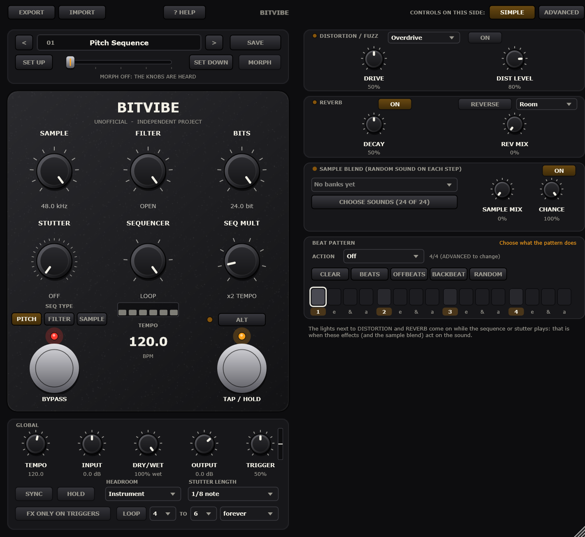
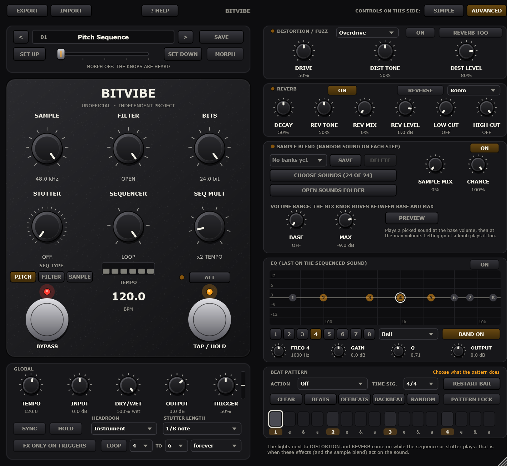

# BitVibe

<table>
  <tr>
    <td align="center"><br><sub>SIMPLE mode</sub></td>
    <td align="center"><br><sub>ADVANCED mode</sub></td>
  </tr>
</table>

**BitVibe** is a free, open-source bitcrusher, filter, stutter and step-sequencer effect for guitar and synths,
with a distortion, reverb, random-sample and EQ section that works only on the sequenced sound. It is a **VST3**
plug-in (plus **Audio Unit** on macOS and a **Standalone** app), written from scratch in C++ with
[JUCE](https://juce.com) and inspired by a hardware pedal (see [Credits](#credits-and-licence)).

> **Status: early version (0.1.0), work in progress.** The sound engine is covered by automated tests
> and the plug-in loads and runs in a test host, but it has had little real-world use in DAWs, and the
> macOS build has not been run on a real Mac yet. Bug reports are welcome.
>
> BitVibe is an independent, unofficial project. It is not affiliated with or endorsed by the makers of
> the hardware that inspired it, and it contains none of their code, firmware or artwork.

[Features](#features) · [Install](#install) · [Using it](#using-it) · [Building](#building-from-source) · [Credits & licence](#credits-and-licence)

## Features

**The pedal**

- **Sample-rate reduction** (48 kHz down to 48 Hz) and **bit-depth reduction** (24 bit down to 1 bit).
- **Ladder-style low-pass filter**, 96 Hz to 24 kHz.
- **Stutter** with 23 positions (3 speeds, 7 repeat counts, off and random) and a hold to freeze it.
- **6-step sequencer** for pitch (+/-12 semitones), filter cutoff or sample rate. Each step can be skipped or
  muted; speed is a 1x to 128x multiple of the tempo (up to 240 BPM, tapped or typed in). A **loop section**
  can keep some of the steps going (a set number of times or forever) while a restart still plays the first ones.
- **Pick detection** starts the stutter and sequencer when you play; an input meter shows what it hears.
- **Expression morph** between two stored sets of knobs, and **16 preset slots** with editable names.
- **Mix**, tempo **sync** to your DAW, input and output gain, and an option to apply the effects **only while
  the stutter or sequencer plays**.

**The right-hand side** (works only on the sequenced and stuttered sound; your clean signal is left alone)

- **Distortion / fuzz:** an overdrive and a fuzz, each with its own knobs.
- **Reverb:** Room, Hall, Spring, Plate, Shimmer and Gated, with decay, tone, level, low and high cut, and a
  reverse option for each type.
- **Sample blend:** a random sound from your own audio files joins each step, crushed along with the sequence.
  Pick sounds, save them as banks, and set a base and a maximum volume.
- **EQ:** an eight-band equalizer with a draggable curve (ADVANCED mode).
- **Beat pattern:** trigger the sequence on chosen steps of the bar, with ten time signatures, a random
  option, a restart-the-bar button and a lock so only the pattern restarts the sequence.
- **SIMPLE or ADVANCED** view, so you only see what you need.

**Also:** export and import presets as XML files to share, a resizable window, hover tips on every control
and a quick-start help page. No reported latency, and light on CPU.

## Install

Download the installer for your system from the **[latest release](https://github.com/d0ge5/BitVibe/releases/latest)**
(each release also lists the files' SHA-256 checksums). To build them yourself instead, see
[Building from source](#building-from-source).

| System | Installer | What it installs |
| --- | --- | --- |
| Windows 10/11, 64-bit | `BitVibe-<version>-Windows-x64-Setup.exe` | VST3 plug-in, optional Standalone app |
| macOS 11+, Apple Silicon or Intel | `BitVibe-<version>-macOS.pkg` | VST3, Audio Unit, optional Standalone app |

Neither installer is code-signed, so your system will warn you the first time.

**Windows**

1. Run the setup. If Windows shows "Windows protected your PC", choose **More info → Run anyway**.
2. Pick **Install for all users** (asks for an administrator password) or **Install for me only**.
3. Accept the licence, choose the full install or the plug-in only, and finish.
4. Open your DAW and rescan plug-ins. BitVibe is listed under **Fx / Distortion**.

No extra runtime is needed. "Install for me only" uses `%LOCALAPPDATA%\Programs\Common\VST3`, which some
DAWs do not scan by default; if the plug-in is missing, add that folder to the DAW's plug-in paths.
Uninstall from *Settings → Apps*.

**macOS**

1. Open the `.pkg` (right-click → **Open** if macOS blocks it).
2. On the *Customize* page tick the formats you want (VST3, Audio Unit, Standalone) and install; it asks
   for your password because it installs for all users.
3. Restart your DAW. Logic Pro uses the Audio Unit and may take a minute to validate it the first time.
4. If macOS blocks the plug-in, open **System Settings → Privacy & Security** and choose **Open Anyway**.

To uninstall, delete `/Library/Audio/Plug-Ins/VST3/BitVibe.vst3`,
`/Library/Audio/Plug-Ins/Components/BitVibe.component` and `/Applications/BitVibe.app`.

## Using it

Click **? HELP** at the top for a one-page quick start (it opens by itself the first time). Hover over any
control for a short description, double-click a knob to reset it, and look at the bubble that shows its value
while you turn it. You can drag the bottom-right corner to resize the window.

### The pedal

| Knob | What it does | Alt layer |
| --- | --- | --- |
| **Sample** | Sample-rate reduction (fully clockwise = off) | Step 1 |
| **Filter** | Ladder low-pass (fully clockwise = off) | Step 2 |
| **Bits** | Bit depth, 24 to 1 bit (fully clockwise = off) | Step 3 |
| **Stutter** | Off, then three speeds with 1 to 16 repeats, then random | Step 4 |
| **Sequencer** | Number of passes: off, once, twice, 4x, 8x, continuous | Step 5 |
| **Seq Mult** | Sequencer speed as a multiple of the tempo | Step 6 |

- **ALT** swaps the knobs for the six sequencer steps. A step at minimum is skipped, at maximum muted.
- **SEQ TYPE** chooses what the steps control: **PITCH**, **FILTER** or **SAMPLE** rate.
- **TAP** sets the tempo (or click the big BPM number and type one). Holding it, or the HOLD button, freezes the stutter.
- **BYPASS** switches the effect off. **TRIGGER** sets how easily picked notes start the stutter and sequencer.
- **LOOP** (under the global knobs) repeats part of the sequence. Choose its first and last step and how often it
  plays (2 to 16 times, or forever); the looped steps are framed on the little step strip. Each time the sequence
  restarts (a hard pick or the beat pattern), it plays from step 1 again, so the steps before the loop come back
  once and then the loop takes over. For example, loop steps 4 to 6 forever on a filter sequence to keep the
  sweep going, while steps 1 to 3 hit again on every restart. The loop is saved with the preset.
- **MIX** blends your clean input with the effect. **FX ONLY ON TRIGGERS** applies the crush and filter only
  while a stutter or sequence plays, so your playing stays clean in between.

It starts on preset 1, a pitch sequence. Turn **Sequencer** to *Off* for a clean signal.

### The right-hand side

All of it hears only the sequenced and stuttered sound. Each section has an **ON** button, and its settings
belong to your rig, so they stay put when you change preset.

- **Distortion / Fuzz:** pick **Overdrive** (modelled on a classic mid-hump overdrive circuit) or **Fuzz**
  (modelled on a classic big fuzz). **REVERB TOO** sends the reverb through it as well.
- **Reverb:** six types; **MIX** starts at 0, so turn it up to hear it. **REVERSE** swells the tail instead
  of fading it.
- **Sample blend:** put your own WAV, AIFF, FLAC or OGG files (up to 20 seconds) in `Documents/BitVibe/Sounds`
  (the **OPEN SOUNDS FOLDER** button gets you there), then **CHOOSE SOUNDS**. **MIX** moves between the **BASE**
  and **MAX** volumes, **CHANCE** is how often a step gets a sound, and **PREVIEW** plays one so you can set the
  volumes by ear. **SAVE** keeps the picked list as a named bank. BitVibe ships no sounds of its own, and your
  picks and banks are remembered between sessions.
- **EQ (ADVANCED):** eight bands, last in the chain. Drag a point for frequency and gain, use the mouse wheel for
  Q, and double-click to switch a band on or off.
- **Beat pattern:** click the steps of the bar where the sequence should trigger, choose a time signature and an
  action (restart, step or stutter), or use **RANDOM** and the ready-made patterns. **RESTART BAR** lines the bar
  up with what you are playing. **PATTERN LOCK** makes the pattern the only thing that restarts the sequence.

### Presets and morph

- The bar at the top holds **16 preset slots** (they also appear as programs in your DAW). `<` and `>` step
  through them and double-clicking the name renames one. Slots 1 to 12 are factory sounds, 13 to 16 are blank.
  Changes are written into a slot only when you press **SAVE**.
- **EXPORT** saves the sound you hear as an XML file (in `Documents/BitVibe/Presets` by default) to give to
  other players. It holds the knobs, steps, effects, beat pattern and the names of your sounds, but not the
  audio files, and not your own levels, trigger setting or sync. **IMPORT** loads such a file into the slot
  that is showing, so pick a free slot first to keep yours.
- **Expression morph:** press **SET UP** with one sound on the knobs and **SET DOWN** with another, switch on
  **MORPH**, and the **Expression** slider (or your DAW automation or a MIDI pedal) blends between them.

## Building from source

JUCE 8 is a git submodule pinned to 8.0.12, so clone with `--recursive`:

```sh
git clone --recursive https://github.com/d0ge5/BitVibe.git
cd BitVibe
# already cloned without it?  git submodule update --init
```

**Windows** needs the Visual Studio C++ workload, CMake and Ninja. `build.bat` expects Visual Studio at
its default 2026 path; edit the `VCVARS` line at the top if yours is elsewhere.

```bat
build.bat                 :: plug-in (VST3 + Standalone) and the DSP tests
build.bat bitvibe_tests   :: just the DSP tests (skips compiling the plug-in)
build\bitvibe_tests.exe   :: run them
```

The VST3 is built to `build\BitVibe_artefacts\Release\VST3\BitVibe.vst3`.

**macOS** needs the Xcode command line tools and CMake, and builds a universal binary with VST3,
Audio Unit and Standalone:

```sh
cmake -S . -B build -DCMAKE_BUILD_TYPE=Release
cmake --build build --parallel
```

### Making the installers

- **Windows:** install [Inno Setup 6](https://jrsoftware.org/isinfo.php) (`winget install JRSoftware.InnoSetup`),
  run `build.bat`, then `installer\windows\build_installer.bat`. The result is
  `dist\BitVibe-<version>-Windows-x64-Setup.exe`.
- **macOS:** needs a Mac. Either run `installer/macos/build_pkg.sh build dist` after building, or run the
  **Build installers** workflow in the repository's *Actions* tab. It builds on a macOS runner, runs the tests,
  validates the Audio Unit with `auval` and uploads `BitVibe-<version>-macOS.pkg` as a workflow artifact.
- The version number lives in the [`VERSION`](VERSION) file. Signing and notarization hooks exist in
  `build_pkg.sh` (configured through environment variables) but have not been tried yet.

<details>
<summary>Tests</summary>

The sound engine is plain C++ with no JUCE dependency and has its own test suite
(`Tests/EngineTests.cpp`, 449 checks), which also passes under MSVC AddressSanitizer and runs on macOS in CI.
Two more tools check the built plug-in:

```bat
cmake -S . -B build -DBITVIBE_BUILD_SMOKETEST=ON
build.bat BitVibeSmokeTest BitVibeEditorSnapshot
```

`BitVibeSmokeTest <.vst3> <outdir>` loads the VST3 in a test host and exercises its parameters, audio,
presets and state. `BitVibeEditorSnapshot <outdir>` renders the editor to PNG without a window (the
screenshots above) and runs processor-level checks. Both exit non-zero if a check fails.

</details>

## Credits and licence

BitVibe is inspired by the **Meris Ottobit Jr.** pedal. It is an independent project and is **not
affiliated with, endorsed by or sponsored by Meris**. "Meris" and "Ottobit" are trademarks of their owner and
are mentioned here only to credit that inspiration.

BitVibe is free software under the [GNU Affero General Public License v3.0](LICENSE). It uses
[JUCE 8](https://juce.com) under JUCE's AGPLv3 option and the MIT-licensed VST 3 SDK; see
[`NOTICE.md`](NOTICE.md). If you distribute a build, the AGPL requires you to make the corresponding source
available to the people you give it to. VST is a trademark of Steinberg Media Technologies GmbH.
