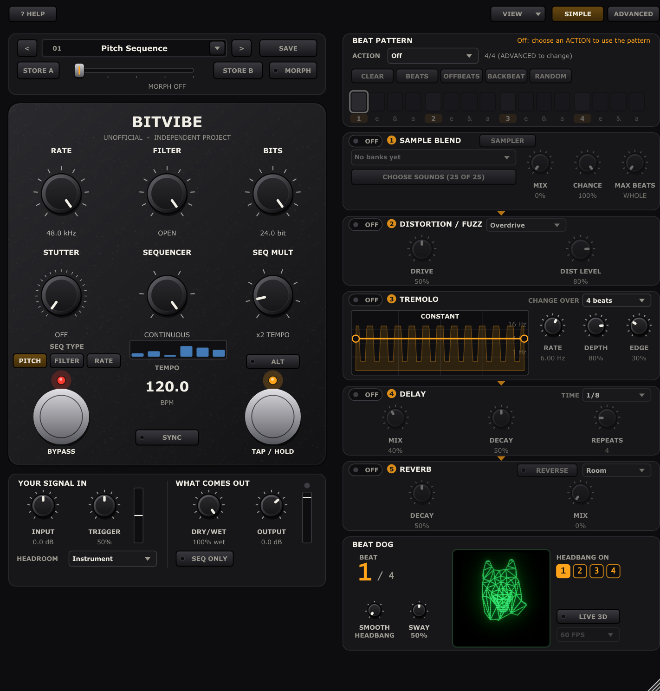
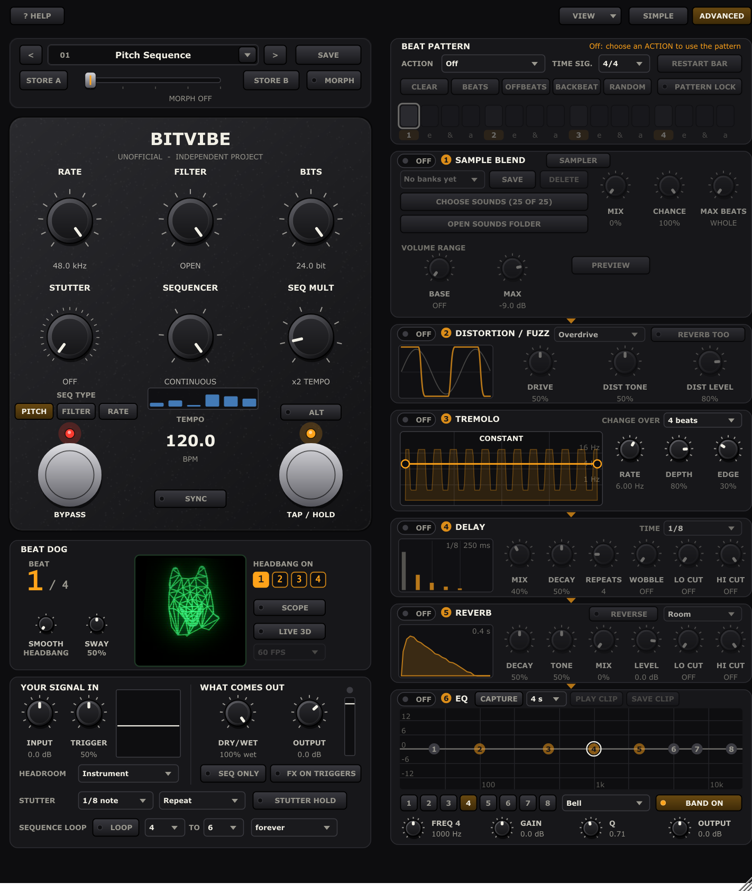
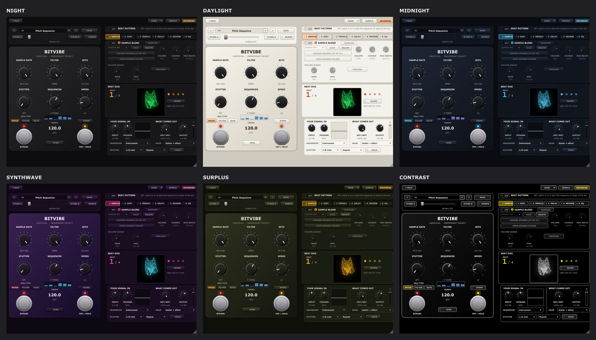
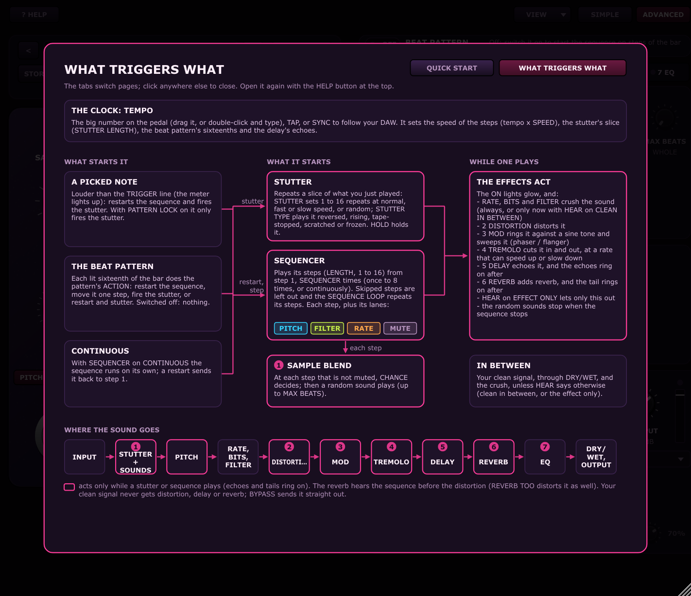
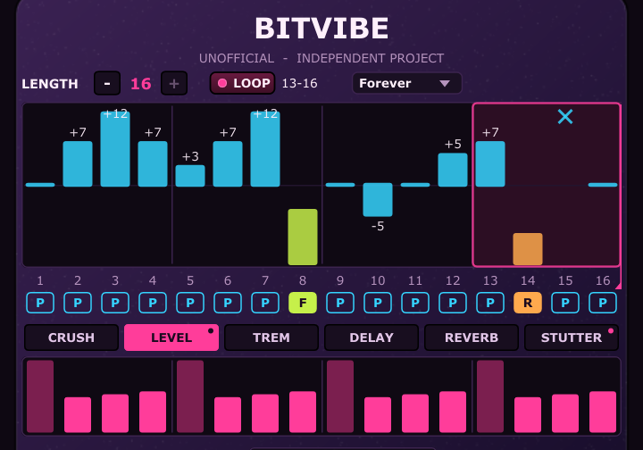
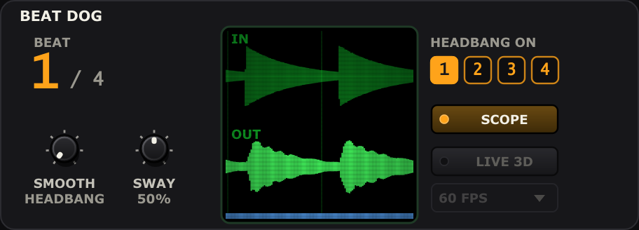
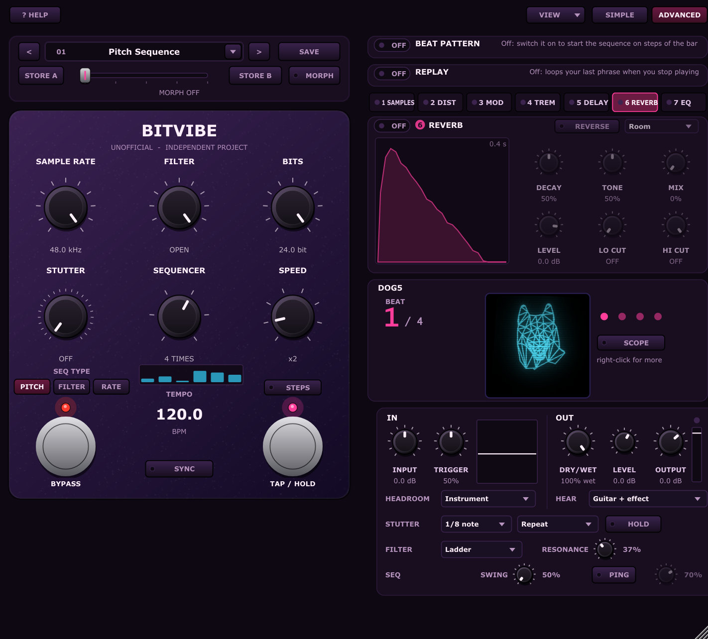
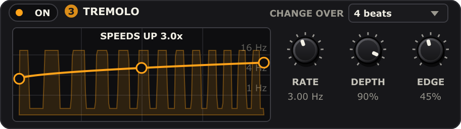
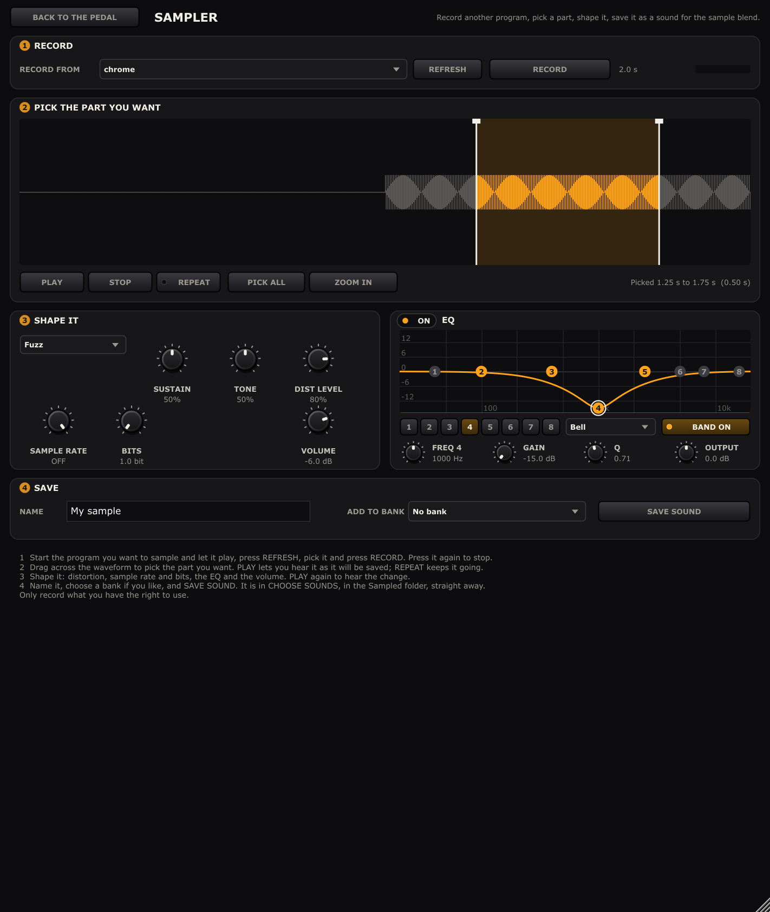

# BitVibe

<table>
  <tr>
    <td align="center"><br><sub>SIMPLE mode</sub></td>
    <td align="center"><br><sub>ADVANCED mode</sub></td>
  </tr>
</table>

**BitVibe** is a free, open-source bitcrusher, filter, stutter and step-sequencer effect for guitar and synths,
with a distortion, reverb, random-sample and EQ section that works only on the sequenced sound. It is a **VST3**
plug-in (plus **Audio Unit** on macOS and a **Standalone** app), written from scratch in C++ with
[JUCE](https://juce.com) and inspired by a hardware pedal (see [Credits](#credits-and-licence)).

> **Status: early version (0.4.0), work in progress.** The sound engine is covered by automated tests
> and the plug-in loads and runs in a test host, but it has had little real-world use in DAWs, and the
> macOS build has not been run on a real Mac yet. Bug reports are welcome.
>
> BitVibe is an independent, unofficial project. It is not affiliated with or endorsed by the makers of
> the hardware that inspired it, and it contains none of their code, firmware or artwork.

**New in 0.4.0:** a **16-step sequencer** with **lanes** (crush, level, tremolo, delay and reverb sends, stutter) in
a step editor, six **stutter types** (repeat, reverse, rise, tape stop, scratch, freeze), five **filter types** with a
**RESONANCE** knob (ladder, low pass, band pass, high pass and an envelope auto-wah), a **tremolo**, **tape wobble**
on the delay, **44 new presets** in one bank of 64 slots, grouped in the preset menu by what each one uses, six
**themes** (SYNTHWAVE to start), and a simpler page with the effects as tabs. See the
[release notes](https://github.com/d0ge5/BitVibe/releases/tag/v0.4.0).

[Features](#features) · [Install](#install) · [Using it](#using-it) · [Building](#building-from-source) · [Credits & licence](#credits-and-licence)

## Features

**The pedal**

- **Sample-rate reduction** (48 kHz down to 48 Hz) and **bit-depth reduction** (24 bit down to 1 bit).
- **Filter** with six types and a **RESONANCE** knob: the ladder-style low-pass (96 Hz to 24 kHz), a cleaner
  two-pole low-pass, a band-pass and a high-pass (96 Hz to 8 kHz), an **envelope** type that opens with each pick,
  and a **res bloom** type where each pick pushes the resonance up instead.
- **Stutter** with 23 positions (3 speeds, 7 repeat counts, off and random), a hold to freeze it, and six **stutter
  types**: repeat, reverse, rise (each repeat a tone higher), tape stop, scratch and freeze.
- **Step sequencer of up to 16 steps** for pitch (+/-12 semitones), filter cutoff or sample rate, chosen for the whole
  sequence or for each step on its own. Each step can be skipped or muted, and has **lanes** for what else it does while
  it plays: crush the bits further, set its level, its share of the tremolo, the delay and the reverb, or fire the
  stutter. Speed is a 1x to 128x multiple of the tempo (up to 240 BPM, dragged, typed or tapped in). A **loop section**
  can keep some of the steps going (a set number of times or forever) while a restart still plays the first ones.
  **SWING** delays every second step, from straight up to a triplet shuffle, and **PING** rings the filter with a
  click at every step, a drum synth that needs no input; both are saved with the preset.
- **Pick detection** starts the stutter and sequencer when you play; an input meter shows what it hears.
- **Expression morph** between two stored sets of knobs, and **one bank of 68 preset slots** with editable names,
  grouped in the preset menu by the features each preset uses.
- **Mix**, tempo **sync** to your DAW, input and output gain, and **HEAR**: the guitar and the effect, the crush
  **only while the stutter or sequencer plays**, or **nothing but the sequenced sound**.

**The right-hand side** (works only on the sequenced and stuttered sound; your clean signal is left alone)

- **Distortion / fuzz:** an overdrive and a fuzz, each with its own knobs.
- **Ring mod:** multiplies the sound by a sine tone (1 Hz to 6 kHz) for metallic, bell-like overtones, with a mix knob.
- **Tremolo:** cuts the sound in and out, smooth or choppy, at a rate that can stay the same or speed up or slow down
  while the sequence plays, drawn and edited as a curve.
- **Delay:** echoes in time with the tempo (1/32 to a bar, with triplets and dotted notes), 1 to 16 repeats or
  forever, with mix, decay, low cut and high cut, and **WOBBLE** to turn it into a worn tape echo.
- **Reverb:** Room, Hall, Spring, Plate, Shimmer and Gated, with decay, tone, level, low and high cut, and a
  reverse option for each type.
- **Sample blend:** a random sound from your own audio files joins each step, crushed along with the sequence.
  Pick sounds, save them as banks, and set a base and a maximum volume. The sequence's loop section can have sounds
  and levels of its own.
- **EQ:** an eight-band equalizer with a draggable curve and a live spectrum (ADVANCED mode). Capture a few
  seconds of the sequenced sound (you choose how much) and loop it through the EQ as a reference while you set it,
  or save it as a WAV.
- **Beat pattern:** trigger the sequence on chosen steps of the bar, with ten time signatures, a random
  option, a restart-the-bar button and a lock so only the pattern restarts the sequence.
- **SIMPLE or ADVANCED** view, so you only see what you need, and the effects as **tabs**, one panel at a time, so the
  whole window fits a laptop screen.
- **Six themes** to pick from the **VIEW** menu: NIGHT, DAYLIGHT, MIDNIGHT, SYNTHWAVE, SURPLUS and CONTRAST.
- **Undo and redo** (Ctrl+Z / Ctrl+Shift+Z, Cmd on a Mac), **Shift-drag** for fine settings, and an **output meter**
  with a clip light.

**Also:** a **sampler** that records another program on your PC (Windows), lets you pick a part and shape it with
distortion, bit crush and an EQ, and saves it as a new sound; export and import presets as XML files to share, a resizable window, hover tips on every control,
host automation sorted into groups (Pedal, Sequencer, Input and Output, each effect)
and a quick-start help page, and **DOG5**, a wireframe husky that headbangs in time. No reported latency, and
light on CPU.

## Install

Download the installer for your system from the **[latest release](https://github.com/d0ge5/BitVibe/releases/latest)**
(each release also lists the files' SHA-256 checksums). To build them yourself instead, see
[Building from source](#building-from-source).

| System | Installer | What it installs |
| --- | --- | --- |
| Windows 10/11, 64-bit | `BitVibe-<version>-Windows-x64-Setup.exe` | VST3 plug-in, optional Standalone app |
| macOS 11+, Apple Silicon or Intel | `BitVibe-<version>-macOS.pkg` | VST3, Audio Unit, optional Standalone app |

Neither installer is code-signed, so your system will warn you the first time.

**Windows**

1. Run the setup. If Windows shows "Windows protected your PC", choose **More info → Run anyway**.
2. Pick **Install for all users** (asks for an administrator password) or **Install for me only**.
3. Accept the licence, choose the full install or the plug-in only, and finish.
4. Open your DAW and rescan plug-ins. BitVibe is listed under **Fx / Distortion**.

No extra runtime is needed. "Install for me only" uses `%LOCALAPPDATA%\Programs\Common\VST3`, which some
DAWs do not scan by default; if the plug-in is missing, add that folder to the DAW's plug-in paths.
Uninstall from *Settings → Apps*.

**macOS**

1. Open the `.pkg` (right-click → **Open** if macOS blocks it).
2. On the *Customize* page tick the formats you want (VST3, Audio Unit, Standalone) and install; it asks
   for your password because it installs for all users.
3. Restart your DAW. Logic Pro uses the Audio Unit and may take a minute to validate it the first time.
4. If macOS blocks the plug-in, open **System Settings → Privacy & Security** and choose **Open Anyway**.

To uninstall, delete `/Library/Audio/Plug-Ins/VST3/BitVibe.vst3`,
`/Library/Audio/Plug-Ins/Components/BitVibe.component` and `/Applications/BitVibe.app`.

## Using it

Click **? HELP** at the top for a quick start (it opens by itself the first time) and **WHAT TRIGGERS WHAT**, a
flow chart of when each part acts (below). Hover over any
control for a short description, double-click a knob to reset it, hold **Shift** while dragging to turn it five
times slower for fine settings, and look at the bubble that shows its value while you turn it. **Ctrl+Z** undoes a
change and **Ctrl+Shift+Z** (or Ctrl+Y) redoes it (Cmd on a Mac); a preset you recalled counts as one change, and so
does a knob turned from grabbing it to letting go. You can drag the bottom-right corner to resize the window; it
remembers the size, and opens smaller when that size would not fit on your screen. **SIMPLE / ADVANCED** (top right)
shows the controls that matter most or all of them, on both sides; what SIMPLE hides keeps working, and the panels
say when a hidden setting is on. A switched-off panel dims its knobs but keeps its names and values readable, so it
can be set up before you switch it on. Buttons with a small light on the left switch something on and off; the
others do something once.

**VIEW** (top right) holds the window size (75% to 150%), **Show DOG5** (hide it and the window gets about
170 pixels shorter) and the theme:

- **NIGHT**: the black pedal with orange lights.
- **DAYLIGHT**: a cream pedal with black knobs, for a bright room.
- **MIDNIGHT**: navy, with cyan lights and a cyan DOG5.
- **SYNTHWAVE**: deep purple, with hot pink lights and a cyan DOG5 (the one it starts in).
- **SURPLUS**: olive drab, with amber lights and an amber DOG5 screen.
- **CONTRAST**: black and white, with yellow lights and strong outlines, the easiest to read.

Only the colours change. Every open BitVibe window follows, and the choice is remembered. Every theme is checked for
contrast, so its text and lights stay easy to read.

<p align="center"></p>

<p align="center"></p>

**What triggers what:** a picked note (louder than the TRIGGER line) restarts the sequence and fires the stutter
(only the stutter with PATTERN LOCK on); the beat pattern does its ACTION on each lit sixteenth; a sequencer on
CONTINUOUS runs by itself. Each step sets its pitch, filter or rate (or mutes) and may bring in a random sound. While
a stutter or sequence plays, the distortion, delay and reverb act and their ON lights glow; the echoes and tails ring
on afterwards. The tempo clock sets the speed of all of it.

### The pedal

| Knob | What it does |
| --- | --- |
| **Sample Rate** | Sample-rate reduction (fully clockwise = off) |
| **Filter** | The filter's cutoff (fully clockwise = off); its type and RESONANCE are in ADVANCED |
| **Bits** | Bit depth, 24 to 1 bit (fully clockwise = off) |
| **Stutter** | Off, then three speeds with 1 to 16 repeats, then random |
| **Sequencer** | Number of passes: off, once, twice, 4x, 8x, continuous |
| **Speed** | Sequencer speed as a multiple of the tempo (x1 to x128) |

- **STEPS** swaps the knobs for the **step editor**:

  <p align="center"></p>

  - **LENGTH** (top left) sets how many steps play, 1 to 16; click **-** / **+** or drag the orange **END** marker under
    the bars. It starts at 6. Steps past the end are dimmed and keep their values for when you lengthen it again.
  - **The bars** are the steps. Drag one up or down, or **drag across several to draw them**. A pitch step moves in
    semitones up or down from the middle line (its value is written by it); a filter or rate step is a percent of
    its knob. Right at the bottom the step is **skipped**, right at the top **muted** (a cross). **Shift** for fine
    control, a **double-click** puts a step back, a **right-click** opens its menu (what it controls, loop it, end the
    sequence there). The playing step lights up; the loop section is framed.
  - **LOOP** (next to LENGTH) repeats part of the sequence: the steps you drag across on the strip above TEMPO (or
    "Loop this step only" in a step's menu), as often as the box says (2 to 16 times, or forever). Each time the
    sequence restarts (a hard pick or the beat pattern), it plays from step 1 again, so the steps before the loop
    come back once and then the loop takes over: loop steps 4 to 6 forever on a filter sequence to keep the sweep
    going, while steps 1 to 3 hit again on every restart. The loop is saved with the preset.
  - **P / F / R** under the step numbers say what each step controls. A lit letter is the step's own choice, an outlined
    one follows **SEQ TYPE**; click to go round them (follow, pitch, filter, rate). Blue is pitch, green filter, purple
    sample rate.
  - **The lanes** are what else each step does while it plays. Pick one with its tab (a dot marks a lane that does
    something) and drag in it like the bars; a double-click puts a step back:
    **CRUSH** fewer bits than the BITS knob (up to one bit), **LEVEL** how loud the step is, **TREM** how much of the
    tremolo it gets, **DELAY** and **REVERB** how much of it goes into them, **STUTTER** fires the stutter as the step
    begins (two repeats if the STUTTER knob is off). They change nothing until you move them.
  - Everything on it is saved with the preset; presets from before keep their six steps and loop.
- **SEQ TYPE** chooses what the steps control: **PITCH**, **FILTER** or **RATE** (the sample rate). It is saved with the
  preset. **Each type remembers its own steps**: set the steps for pitch, press FILTER and set them for the filter, and
  pressing PITCH again brings the pitch steps back exactly as you left them (a type you have not used yet starts from
  the steps as they are). Steps with a P / F / R choice of their own stay put through the switch. The remembered
  steps are saved with the preset and travel in exported preset files.
- **The step strip** (the coloured bars above TEMPO) is the sequence at a glance: one bar per step that plays, the
  playing step outlined, the loop section framed. Click a step to see it on STEPS, **drag across steps** to make them
  the loop section, and **right-click** a step to set what it controls, loop it alone or end the sequence there.
- **TEMPO** is the big number in the middle: drag it up or down, double-click it to type a BPM, or tap **TAP**.
  **SYNC** under it follows your DAW's tempo instead. Holding TAP freezes the stutter for as long as you hold it.
- **BYPASS** switches the effect off.

At the bottom of the right-hand side, **IN** has **INPUT**, **TRIGGER** (how easily picked notes start the
stutter and sequencer) with the last three seconds of your playing scrolling past the trigger line: a pick that
crosses it is caught, lit orange with a mark on top, so setting TRIGGER comes down to seeing which notes make it over
the line; and **HEADROOM** (Instrument or Line: set it first). **OUT** has **DRY/WET**, **OUTPUT** with an
output meter (its light turns red when the output goes over 0 dB and stays lit for a few seconds; click it to put it
out) and **HEAR**. ADVANCED adds a **STUTTER** row: its length (a note length of the tempo), its type and **HOLD**;
a **FILTER** row: the filter's type and its **RESONANCE**; and a **SEQ** row with **SWING** and **PING**:

- **HEAR** is what comes out. **Guitar + effect**: both, blended with DRY/WET. **Clean in between**: the crush and
  filter act only while a stutter or sequence plays, so your playing stays clean in between. **Effect only**: your
  clean signal is cut, so only the sequenced sound leaves the plug-in: silence between sequences (the echoes and
  reverb still ring out) and DRY/WET does nothing. Handy on a parallel track or with the clean guitar on another channel.
- **HOLD** freezes the stutter on the current (or next) note until you switch it off; holding the TAP footswitch does
  the same for as long as you hold it.

- **STUTTER TYPE** is what the stutter does with the slice it catches. The STUTTER knob's repeats and speed still
  count: **REPEAT** plays the slice that many times (as before), **REVERSE** plays it backwards, **RISE** plays each
  repeat a whole tone higher than the last (up to two octaves), **TAPE STOP** slows it down to a stop like a tape
  machine switched off (taking that many slices to stop), **SCRATCH** pushes it back and forth like a record under a
  hand (one push and pull per slice), and **FREEZE** holds the end of it as a steady cloud of tiny overlapping grains
  for that many slices. With HOLD each of them goes on until you let go. The knob's read-out names the type,
  it is saved with the preset, and in SIMPLE a type other than REPEAT is listed under "Also on".
- **FILTER TYPE** is what the FILTER knob is the cutoff of. **LADDER** is the pedal's own four-pole low-pass
  (24 dB/oct). **LOW PASS** is a two-pole one (12 dB/oct): cleaner and more like a synth. **BAND PASS** leaves only
  the sound around the cutoff and **HIGH PASS** only the sound above it, thin; these two run 96 Hz to 8 kHz, as there
  would be nothing left at 24 kHz. **ENVELOPE** is an auto-wah: the ladder, resting where FILTER sets it and opened
  up to three octaves by each picked note, closing again as the note dies away. **RES BLOOM** is the ladder again,
  but each pick pushes the **RESONANCE** up instead, so every note starts vocal and relaxes as it dies. For every
  type fully right is off, and a filter step in the sequence is still a percent of the knob.
- **RESONANCE** is a peak at the cutoff: turn it right for a sharper, more vocal sweep; fully right the ladder is
  just short of whistling by itself and the others peak hard. Its middle setting (37%, double-click to get back
  to it) is the resonance the pedal always had. Both are saved with the preset, and in SIMPLE a type other than
  LADDER or a changed RESONANCE is listed under "Also on".
- **SWING** makes every second step wait a little, like a drum machine's shuffle: 50% is straight, 67% a full
  triplet feel, and each pair of steps keeps the tempo, so nothing drifts. It is part of the sequence (saved with
  the preset), it works at any speed and length, and in SIMPLE a swing above 50% is listed under "Also on".
- **PING** drops a tiny click into the chain at the start of every step (muted steps stay silent), so a resonant
  filter rings at its cutoff like a drum synth: turn **RESONANCE** up and **FILTER** down to tune it, and let
  filter steps play it. It sounds with no input at all, its **LEVEL** knob sets how hard the click hits, it is
  saved with the preset, and in SIMPLE it is listed under "Also on" while it is on.

It starts on preset 1, a pitch sequence that plays four times after each picked note. Turn **Sequencer** to *Off*
for a clean signal, or to *Continuous* to have it run on its own.

**DOG5** (in the right-hand column, under the effects) is a wireframe husky in the theme's screen colour
that headbangs in time: its head nods forward on the beat and pulls back again, ears flopping, with the beat of the
bar beside it. It follows the tempo, or the host's tempo and position with SYNC on (it stops when the host stops). It is a pre-rendered
animation (32 frames of one beat, rendered in Blender by `Tools/beatdog/build_beat_dog.py` into
`Assets/beat_dog.jpg`), so it costs one small image draw per frame. **Right-click the dog** for its settings:
**HEADBANG ON** picks the beats of the bar the head nods forward on (the lit dots beside the screen); it pulls back
smoothly in between (pick fewer beats for a slower, heavier headbang). **SMOOTH** sets how much quicker the nod
forward is, from a sudden headbang to an even bob, forward and back alike. **SWAY** floats the head from side to
side, landing on one side at a picked beat and the other at the next. **LIVE 3D** draws the head in real time from
its 3D mesh instead (exported by the same script into `Source/BeatDogMesh.h`), at **60**, **30** or **15 FPS**:
smoother, and still light (well under a millisecond a frame). All of it is remembered.

**SCOPE** turns DOG5's screen into an oscilloscope of the last two beats: your clean input on top (**IN**), what
comes out below (**OUT**), a line on each beat and, along the bottom, a strip in the colour of the step that was
playing. Side by side you can see what the sequence does to your playing: the stutter repeating a slice, a muted
step going flat, the crush, the tremolo cutting, the echoes trailing on.

<p align="center"></p>

### The right-hand side

At the top, the **beat pattern** decides when the sequence fires; it has a power button like the effects and folds to
its title row while it is off. Below it, the effects are **numbered tabs** in the order the sequenced sound goes
through them: **1** sample blend, **2** distortion / fuzz, **3** ring mod, **4** tremolo, **5** delay, **6** reverb,
**7** EQ (ADVANCED). One panel shows at a time; click a tab to see it (the choice is remembered). They hear only the
sequenced and stuttered sound. Each tab has a light that is on when its effect is on and glows while the sequence or
stutter plays (which is when the effect acts); each panel has the same power button next to its title, and a
switched-off panel is dimmed.

<p align="center"></p>
They all start off. Switching on the reverb or the sample blend with its mix at 0% brings the mix up, so you hear it.
The distortion, delay and reverb panels each have a small graph on the left of what the effect does, worked out by
running the effect itself, so it changes as you turn the knobs: the distortion shows a plain tone going in (grey) and
what comes out; the delay shows a note and its echoes on the beat lines, with the time in ms; the reverb shows the
tail after a short note, loud at the top and quiet at the bottom, and how long it rings.
The effects and the beat pattern are part of a preset: recalling a slot sets them as the slot has them, and SAVE
keeps them with it.

- **Beat pattern:** click the steps of the bar where the sequence should trigger, choose a time signature and an
  action (restart, step or stutter), or use **RANDOM** and the ready-made patterns. **RESTART BAR** lines the bar
  up with what you are playing. **PATTERN LOCK** makes the pattern the only thing that restarts the sequence. While
  the action is *Off* the pattern does nothing, and the grid is dimmed to show it.
- **Sample blend:** put your own WAV, AIFF, FLAC or OGG files (up to 20 seconds) in `Documents/BitVibe/Sounds`
  (the **OPEN SOUNDS FOLDER** button gets you there), then **CHOOSE SOUNDS**. With no sounds at all the panel says
  **NO SOUNDS YET** and shows the folder button; the first sounds you add are found and picked by themselves. Subfolders are read too, and CHOOSE
  SOUNDS shows each one as a submenu with its own *Pick all* and *Pick none*, so a sorted library stays easy to pick
  from. File names must differ across folders (a name found twice is used once). Free sound packs released under CC0,
  such as [Kenney's audio packs](https://kenney.nl/assets/category:Audio), work well. **VOLUME** moves between the **BASE**
  and **MAX** volumes (ADVANCED), **CHANCE** is how often a step gets a sound, **MAX BEATS** is the longest a sound may play
  (a quarter beat up to 8 beats of the tempo, or the whole sound) before it fades out, which tames long sounds, and
  **PREVIEW** plays one so you can set the volumes by ear. **SAVE** keeps the picked list as a named bank. BitVibe ships no sounds of its own, and your
  picks and banks are remembered between sessions. While the **LOOP** is on (see the step editor above), **OTHER STEPS** and
  **LOOP STEPS** buttons appear: LOOP STEPS sets up the loop section's steps. Its bank list starts on **Same as the other steps**; pick a bank or
  choose sounds to give the loop steps a list of their own. **OWN LEVELS FOR THE LOOP** gives them their own
  VOLUME, CHANCE, BASE and MAX, starting from the main values; off, they use the main ones.
- **Distortion / Fuzz:** pick **Overdrive** (modelled on a classic mid-hump overdrive circuit) or **Fuzz**
  (modelled on a classic big fuzz). **REVERB TOO** sends the reverb through it as well.
- **Ring mod:** multiplies the sequenced sound by a sine tone, the classic way to make it metallic and bell-like.
  **FREQUENCY** is the tone, 1 Hz to 6 kHz: very low it wobbles like a tremolo, higher it turns clangorous and
  inharmonic, and it is worth tuning near a note of the song. **MIX** blends it in, up to only the rung sound.
  It sits after the distortion and before the tremolo, so the delay's echoes carry it too.
- **Tremolo:** cuts the sequenced sound in and out while a sequence or stutter plays. **RATE** is how fast (0.5 to
  20 times a second), **DEPTH** how far the volume drops (fully right, it cuts right out), **EDGE** how hard: a
  smooth swell to the left, a hard on/off chop to the right. The graph shows the rate over the **CHANGE OVER** time
  (1 to 16 beats from the start of each sequence or stutter; after that it stays at the end rate), with the tremolo
  itself drawn behind it, so you can see the cuts bunch up or spread out. Drag the **left point** to set the rate it
  starts at, the **right point** to set where it ends: higher speeds it up (a shorter period), lower slows it down,
  level keeps it constant (it snaps there). The **middle point** bends the curve, so the change comes early or late.
  Double-click a point to put it back, or the graph to make the rate constant again. The RATE knob moves the whole
  curve; a line shows where a playing sequence is. It comes after the distortion and before the delay, so the
  echoes are chopped too.

  <p align="center"></p>

- **Delay:** a stutter for the sequenced sound itself. **TIME** is a note length of the tempo (1/32 up to a whole
  bar, with T for triplets and D for dotted notes), so the echoes always sit in time, also with SYNC on. **REPEATS** is
  how many echoes follow each sound (1 to 16, or **FOREVER** fully right), **DECAY** how much quieter each one is than
  the one before, **MIX** how loud they are, and **LO CUT** / **HI CUT** (ADVANCED) filter the echoes only.
  **WOBBLE** makes it a worn tape echo: the echoes waver in pitch, a slow wandering wow with a fast flutter on top,
  each later echo a little more (on FOREVER the wobble builds up trip after trip), and they get darker and softer the
  further it is turned (the high cut closes towards 6 kHz). Fully left it is a clean digital delay; the graph shows
  the echoes drifting off the beat and says TAPE. It hears
  the sound after the distortion and the tremolo; the reverb hears the echoes too, and they ring on after the sequence stops.
- **Reverb:** six types; **MIX** starts at 0, so turn it up to hear it. **REVERSE** swells the tail instead
  of fading it.
- **EQ (ADVANCED):** eight bands, last in the chain. Drag a point for frequency and gain, use the mouse wheel for
  Q, and double-click to switch a band on or off. Behind the curve is the spectrum of the sound reaching the EQ
  (grey) and, with the EQ on, of what comes out (orange). **CAPTURE** keeps the last few seconds (up to 8) of the
  sound reaching the EQ, and the box next to it sets how much of the end of the clip is used (half a second to 8
  seconds, changeable after capturing); **PLAY CLIP** loops that clip through the EQ instead of the live sound, so you can set the
  EQ with your hands free (press it again to go back); **SAVE CLIP** writes the clip to a WAV file
  (`Documents/BitVibe/Clips` by default). The clip lasts until you capture again or the sample rate changes, and
  is not saved with the project.

### The sampler

<p align="center"></p>

**SAMPLER** (in the sample blend panel's title row) opens a page over the whole window for making your own sounds out
of what another program on your computer is playing. **BACK TO THE PEDAL** closes it.

1. **Record:** start the program and let it play, press **REFRESH**, pick it in **RECORD FROM** (or *Everything
   except* the host you run BitVibe in) and press **RECORD**; press it again to stop. A recording is up to a minute.
   This uses Windows' per-program recording, so it needs Windows 10 version 2004 or Windows 11; on macOS the page
   opens but cannot record yet.
2. **Pick the part:** drag across the waveform; drag the white edges to adjust; **ZOOM IN** to set them exactly.
   **PLAY** plays the picked part as it will be saved, and changes to the effects are heard while it plays. **REPEAT**
   keeps playing it over and over (also while you move its edges), so you can tweak the settings as you listen.
3. **Shape it:** **DISTORTION** (off, the overdrive or the fuzz from the right-hand column, with DRIVE, TONE and
   DIST LEVEL), **SAMPLE RATE** and **BITS** (the pedal's own crush), an **EQ** (the same panel as the main EQ, with
   settings of its own, showing the spectrum of what PLAY or REPEAT is playing before and after it) and **VOLUME**. The sound is levelled like every other sound, and VOLUME then says how loud it
   sits next to them (0 dB = as loud as the others, -6 dB = half as loud); BitVibe keeps that level when it plays it.
4. **Save:** give it a name, choose a bank to add it to if you like, and **SAVE SOUND**. It is saved as a WAV in the
   sounds folder's **Sampled** subfolder and shows up in CHOOSE SOUNDS straight away. The sample blend uses up to 20
   seconds of a sound.

Only record what you have the right to use.

### Presets and morph

- The bar at the top holds **one bank of 68 preset slots** (they also appear as programs in your DAW). `<` and `>`
  step through them. Slots 1 to 12 are factory sounds, 13 to 20 are empty for your own, and 21 to 68 are the preset
  pack. A slot holds the whole sound: the knobs, steps, lanes, tempo and morph, the effects on the right-hand side and
  the beat pattern. Your input, output, headroom, trigger, sync, DRY/WET, HEAR and the sample blend's levels stay as
  they are when you change slot. Changes are written into a slot only when you press **SAVE**. A project saved by an older version keeps its
  sixteen slots where they were; recalling one of those leaves the effects as they are, as it did then.
- **Click the name** (or the arrow beside it) for the preset menu. The presets are **grouped by what they use**:
  under SEQUENCER (pitch, filter or sample-rate steps, plays on its own or after each pick, long sequences, step
  lanes, the sequence loop, the beat pattern), STUTTER (the stutter, the stutter types), SOUND (bit crush and sample
  rate, filter types and resonance), EFFECTS (distortion, tremolo, delay, tape wobble, reverb, EQ) and MORPH. A preset
  is in every group it uses, and your own saved sounds are sorted the same way. **All presets** lists the 68 in order
  and **Your slots** the empty ones. Then **Undo** and **Redo**, save, rename, **Export to a file** and **Import from
  a file**.
  Export saves the sound you hear as an XML file (in `Documents/BitVibe/Presets` by default) to give to
  other players. It holds the knobs, steps, effects, beat pattern and the names of your sounds, but not the
  audio files, and not your own levels, trigger setting or sync. Import loads such a file into the slot
  that is showing, so pick a free slot first to keep yours.
- **Preset pack:** forty-eight sounds built around the 16-step sequencer, its lanes, the stutter types, the tremolo,
  the delay's tape wobble, the filter types, swing, the ping and the ring mod, in slots 21 to 68 (your picked sounds stay as they are). Save over
  one and it stays yours; the same files are in [`Presets/`](Presets) to share or import.
  The long patterns switch **PATTERN LOCK** on, so they run freely and a pick fires only the stutter.

  | | | |
  | --- | --- | --- |
  | **Arp Sixteen**: a two-bar arpeggio in sixteenths, accented, with dotted echoes | **Glass Stairs**: each pick climbs in whole tones into a shimmer | **Tape Brake**: picks grind to a halt over a bar |
  | **Scratch Cut**: scratched picks, and a scratch on beats 2 and 4 | **Frozen Pad**: a pick held as a breathing cloud in a long hall | **Backwards Rain**: reversed picks into echoes and a reversed hall |
  | **Gate Grid**: a sixteen-step gate on a fuzzed chord | **Crush Accents**: clean on the beat, crushed in between | **Dub Throws**: only the off-beats go into the echoes and the spring |
  | **Stutter Machine**: a filter sequence that stutters by itself | **Filter Walk 12**: twelve filter steps against a bar of sixteen | **Five Against Four**: a five-note figure over four beats |
  | **Rate Ramp**: a dive through the sample rate, then a loop | **Tremolo Rush**: a tremolo that speeds up over two bars | **Mixed Signals**: pitch, filter and rate steps in turn |
  | **Octave Bounce**: bouncing octaves with a rising stutter | **Lo-Fi Shuffle**: a dusty long-short gate over three beats | **Reverb Swells**: two steps swell backwards into a hall |
  | **Freeze and Glide**: a melody that freezes on each bar's first step | **Chaos Engine**: random scratches, mixed steps, crush and fuzz | **Worn Cassette**: crunchy and dark, its echoes sagging |
  | **Seasick Arp**: a minor arpeggio with echoes sliding out of tune | **Half-Speed Scratch**: picks dragged back and forth an octave down | **Reverse Climb**: sixteen steps up, flipping backwards at the top |
  | **Tape Stop Fill**: a sixteenth groove that brakes at the end of each bar | **Pulse Width**: a square tremolo thinning out step by step | **Slow Motion**: a falling line under a tremolo that slows to a crawl |
  | **Bitstorm**: the sample rate rattling in thirty-seconds, random stutters | **Ghost Notes**: quiet ghost steps round the accents, a worn echo | **Frozen Steps**: a rising figure freezing into shimmer on every beat |
  | **Echo Ladder**: each step sends more to the echoes as the line climbs | **Underwater**: a low swaying filter, slow tremolo, drowned tape echo | **Acid Walk**: a resonant band-pass walking sixteen steps, with a sixteenth echo |
  | **Wah Picks**: an auto-wah on a four-note figure, into a spring | **Squelch Ladder**: the ladder near to whistling, swept by eight steps | **Thin Air**: a high-pass climbing over a bar and falling back, under a tremolo |
  | **Wah Pedal**: no sequence, just the auto-wah on what you play | **Vowel Steps**: a sharp band-pass jumping between vowel-like places | **Resonant Dive**: each pick falls from open to shut, into wobbling echoes |
  | **Acid Bass Loop**: an octave-jumping bass line with filter steps and a fuzz | **Radio Dial**: a band-pass hopping about, crushed as it goes | **Thin Reverse**: a high-pass climbing while reversed stutters fire |
  | **Peak Pulse**: a resonant low-pass snapping open under a square tremolo | **Whistle Freeze**: the ladder at full resonance, frozen into a shimmer | |
- **Expression morph:** press **STORE A** with one sound on the knobs and **STORE B** with another, switch on
  **MORPH**, and the **Expression** slider (or your DAW automation or a MIDI pedal) blends between them.

## Building from source

JUCE 8 is a git submodule pinned to 8.0.12, so clone with `--recursive`:

```sh
git clone --recursive https://github.com/d0ge5/BitVibe.git
cd BitVibe
# already cloned without it?  git submodule update --init
```

**Windows** needs the Visual Studio C++ workload, CMake and Ninja. `build.bat` expects Visual Studio at
its default 2026 path; edit the `VCVARS` line at the top if yours is elsewhere.

```bat
build.bat                 :: plug-in (VST3 + Standalone) and the DSP tests
build.bat bitvibe_tests   :: just the DSP tests (skips compiling the plug-in)
build\bitvibe_tests.exe   :: run them
```

The VST3 is built to `build\BitVibe_artefacts\Release\VST3\BitVibe.vst3`.

**macOS** needs the Xcode command line tools and CMake, and builds a universal binary with VST3,
Audio Unit and Standalone:

```sh
cmake -S . -B build -DCMAKE_BUILD_TYPE=Release
cmake --build build --parallel
```

### Making the installers

- **Windows:** install [Inno Setup 6](https://jrsoftware.org/isinfo.php) (`winget install JRSoftware.InnoSetup`),
  run `build.bat`, then `installer\windows\build_installer.bat`. The result is
  `dist\BitVibe-<version>-Windows-x64-Setup.exe`.
- **macOS:** needs a Mac. Either run `installer/macos/build_pkg.sh build dist` after building, or run the
  **Build installers** workflow in the repository's *Actions* tab. It builds on a macOS runner, runs the tests,
  validates the Audio Unit with `auval` and uploads `BitVibe-<version>-macOS.pkg` as a workflow artifact.
- The version number lives in the [`VERSION`](VERSION) file. Signing and notarization hooks exist in
  `build_pkg.sh` (configured through environment variables) but have not been tried yet.

<details>
<summary>Tests</summary>

The sound engine is plain C++ with no JUCE dependency and has its own test suite
(`Tests/EngineTests.cpp`, 508 checks), which also passes under MSVC AddressSanitizer and runs on macOS in CI.
Two more tools check the built plug-in:

```bat
cmake -S . -B build -DBITVIBE_BUILD_SMOKETEST=ON
build.bat BitVibeSmokeTest BitVibeEditorSnapshot
```

`BitVibeSmokeTest <.vst3> <outdir>` loads the VST3 in a test host and exercises its parameters, audio,
presets and state. `BitVibeEditorSnapshot <outdir>` renders the editor to PNG without a window (the
screenshots above) and runs processor-level checks. Both exit non-zero if a check fails.
The preset pack is written from the table in `Tools/PresetPack.h` with `BitVibeEditorSnapshot --write-presets Presets`
(then rebuild, so the plug-in embeds the new files); the snapshot checks fail if the files and the table disagree.

</details>

## Credits and licence

BitVibe is inspired by the **Meris Ottobit Jr.** pedal. It is an independent project and is **not
affiliated with, endorsed by or sponsored by Meris**. "Meris" and "Ottobit" are trademarks of their owner and
are mentioned here only to credit that inspiration.

BitVibe is free software under the [GNU Affero General Public License v3.0](LICENSE). It uses
[JUCE 8](https://juce.com) under JUCE's AGPLv3 option and the MIT-licensed VST 3 SDK; see
[`NOTICE.md`](NOTICE.md). If you distribute a build, the AGPL requires you to make the corresponding source
available to the people you give it to. VST is a trademark of Steinberg Media Technologies GmbH.
